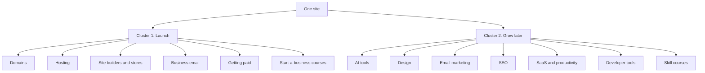
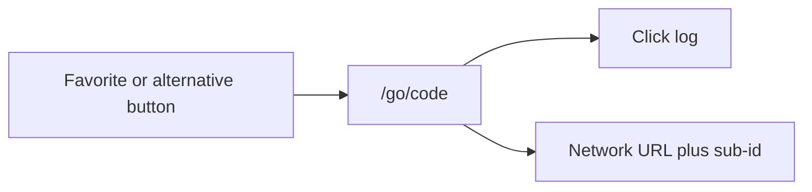
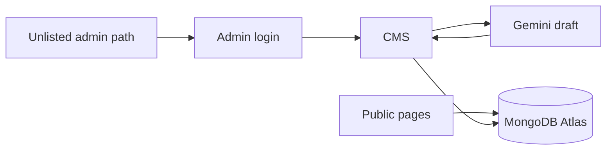

# Handoff

This file is the whole brief. Build from it. Do not look for a Predikt codebase, a previous chat, or logo image files. Those stay on the first Mac.

The app is the Next.js App Router project at `/Users/layobright/Desktop/clevorah`. Do not put it inside Predikt. Do not use `/Volumes/Untitled/clevorah`. That USB volume mounts read-only on this Mac.

The publisher lives in Nigeria. The site is in English and can be read from anywhere. A brand approves the publisher’s country and the buyer’s country separately. Amazon Associates does not accept a Nigerian applicant. Do not invent affiliate signup URLs, commission amounts, or country rules. Store those only after the publisher pastes them into the CMS.

The logo is not chosen. Use the word Clevorah as the header mark. Three unused mark ideas, if asked later, are a stack of three bars, two cards with one filled and one outlined, and a page with a folded corner. Do not generate a logo during the build.

The first build leaves the 20 comparison articles as drafts. Public pages at the end of the build are the home page, the Launch hub, the six Launch category pages, and About, Contact, Disclosure, and Privacy. That is 12 public URLs. The figure of 32 is the site after those drafts are published. Grow stays out of the header and off the home page until one Grow article is published.

# Cluster 1 and Cluster 2

The product name is Clevorah. It is the name in the header, the About page, and the site metadata. The header uses the word Clevorah until a logo mark is chosen.

All categories:

- Domains
- Hosting
- Site builders and stores
- Business email
- Getting paid
- Start-a-business courses
- AI tools
- Design
- Email marketing
- SEO
- SaaS and productivity
- Developer tools
- Skill courses

One website. Two sections. Cluster 1 is what you publish first. Cluster 2 stays a separate section and is filled in after Cluster 1 has real articles and a few approved brands.

A brand should land in one section only. Business email (a mailbox on your domain) stays in Cluster 1. Email marketing (newsletters to a list) stays in Cluster 2.

## Cluster 1 — Launch a business online

The buyer does not have a site yet. They need a name, a host, a way to build the site, a business inbox, and a way to take payment.

- **Domains.** Buying and connecting a domain. Brands: Namecheap, GoDaddy, Hostinger, WhoGoHost for .ng.
- **Web hosting.** Shared, WordPress, and cloud hosting, plus renewals. Brands: Hostinger, Bluehost, Cloudways, SiteGround, WhoGoHost.
- **Site builders and online stores.** Tools that create the site or the shop. Brands: Shopify, Wix, WordPress, Systeme.io. Shopify covers both a site and a store, so it lives here, not in a second category.
- **Business email.** A professional address on the domain, such as hello@yourbusiness.com. Brands: Zoho Mail, Google Workspace, Hostinger Email, WhoGoHost Cloud Mail.
- **Getting paid.** How the new business accepts money. Global brands: Stripe, PayPal. Nigeria brands: Paystack, Flutterwave. Only list a brand after you confirm it has an affiliate program that accepts you.
- **Start-a-business courses.** How to start a blog, open a store, or set up the first site. Brands: Udemy, Coursera, Selar.

Apply to about two brands in each of these six topics. On one page, recommend one favorite and one alternative.

Example pages that stay in this cluster:

- Turn your ideas into a page. Use-case page under site builders.
- Best website builders for small business. Best-of page under site builders.
- Best ecommerce platforms for Nigerian business. Best-of page under site builders and stores. The audience is Nigerian buyers, so only brands that sell there get a button.

## Cluster 2 — Grow the business

Add this section later, on the same site, as its own menu. The buyer already has a site and now needs tools to get customers. These pages stay out of the Cluster 1 reviews.

Hosting, builders, business email, and payments are software too, and they stay in Cluster 1 because the job is launching. The topics below are the software you add after that.

- **AI tools.** Writing, images, and assistants for a small business. Brands: Jasper, Copy.ai, Writesonic. Page: Best AI tools for small business.
- **Design.** Logos, social posts, and simple graphics. Brand: Canva.
- **Email marketing.** Sending newsletters to a list. This is not business email. Brands: Kit, Brevo, MailerLite, ActiveCampaign. Page: Best email marketing platforms.
- **SEO.** Keywords, rankings, and content optimization. Brands: Semrush, Surfer, Mangools. Pages: Best SEO tools for small business, and Semrush vs Ahrefs. Ahrefs can appear in the comparison with no button until an open program accepts you.
- **SaaS and productivity.** Accounting, invoicing, notes, and task tools for a business that already exists. Candidates: QuickBooks, Xero, Wave, Notion, ClickUp. Page: Best accounting software for freelancers. Confirm each program before applying.
- **Developer tools.** Code hosting, preview hosting, and APIs. Candidates: GitHub, Vercel. Web hosting stays in Cluster 1.
- **Skill courses.** Writing, design, SEO, and digital marketing. Brands: Udemy, Coursera, Skillshare. “How to start” stays in Cluster 1. “How to get traffic” stays here.

## How the two stay acceptable to brands

- Cluster 1 URLs and menu items talk about launching: domains, hosting, builders, business email, payments.
- Cluster 2 URLs and menu items talk about growing: AI tools, design, email marketing, SEO, SaaS and productivity, developer tools.
- Each application points at the matching section. A host is shown the hosting comparisons. Semrush is shown the SEO comparisons.
- The homepage shows Launch only until Grow has at least one published article. Each comparison stays inside one section.
- Before each application, check the brand’s country rule. A fitting category still fails if the program blocks Nigerian publishers or the buyer’s country.

## Pages brands approve

The public site is a set of comparisons, not a blog. Every page answers one buying question and names one favorite and one alternative.

Three page types:

- **Best-of.** “Best website builders for small business.” Favorite, alternative, then a short table.
- **Versus.** “Semrush vs Ahrefs.” A verdict at the top: choose A if this, choose B if that.
- **Use-case.** “Turn your ideas into a page.” The job, the favorite tool, the alternative, and the first steps.

A page also stores an audience: small business, freelancers, Nigerian business, or a worldwide reader. “Best ecommerce platforms for Nigerian business” is a Cluster 1 best-of page with the Nigerian audience. The same brands can appear on a worldwide page only when that program pays for those buyers.

What brands expect to see on the page:

- A visible date and a method: what was compared, and who each option is for.
- The favorite and the alternative named in the first screen.
- A reason to skip each tool.
- A commission notice on the page, next to the first recommendation.
- Your own wording. Gemini fills the fields. You edit the verdict before it publishes.

What stays off the page: a long list of equal buy buttons, coupon popups, fake countdown timers, and a newsletter that must be joined before the recommendation is visible.

## Design system

One editorial layout for every comparison. Brands recognize a review site. Readers see the pick immediately.

Structure, from top to bottom:

- Header with the Clevorah wordmark, Launch, and About and Contact. Grow appears in the header only after it has a published article. On a phone the links sit in a plain list under a button.
- Page title and the audience.
- One line that the page contains affiliate links.
- Favorite card: who it is for, why it won, one button.
- Alternative card: when to choose it instead, one outline button.
- Criteria list: price level, best for, and the limit. On a phone this is stacked. On a desktop it is rows.
- Short answers to the likely questions.
- Newsletter at the bottom of the page and in the footer.
- Footer with the commission notice again, About, Contact, Disclosure, and Privacy.

Visual rules:

- Off-white background, near-black text, one flat accent color used only on the favorite button.
- Separation comes from a 1px border and spacing. No gradients, no box shadows, no drop shadows, and no text shadows.
- Lucide icons for criteria, at a small size.
- The alternative never uses the same filled button as the favorite.
- No star ratings unless the CMS stored the criteria those stars came from.
- No arrival popup, no sticky bar that covers the pick, and no more than two buttons per product.

CMS fields match this layout: page type, cluster, topic, audience, favorite, alternative, criteria, who should skip it, and publish status. Gemini writes those fields. It does not invent a different layout.

## Build specification

This is a new Next.js App Router app, separate from Predikt. Next.js, TypeScript, Tailwind, Lucide, and MongoDB Atlas. One set of templates renders every public URL from published CMS documents.

Build order:

1. App shell, design tokens, header, footer, and the four trust pages.
2. MongoDB models and the public templates for home, cluster, topic, and comparison.
3. CMS behind the unlisted path, with login.
4. Gemini drafts, click redirect, Analytics, Search Console, and newsletter confirmation.

Colors, all flat:

- Page background `#F6F5F2`.
- Card background `#FFFFFF`.
- Primary text `#171717`.
- Secondary text `#5E5C57`.
- Border `#E3E1DB`, 1px.
- Favorite button `#1F4D3A` with white label `#FFFFFF`. Hover is a second flat color, `#183E2E`.
- The alternative button is white with a `#171717` border and `#171717` text.

Font family is Geist Sans, loaded with `next/font`. Sizes:

- Body 16px, line height 1.6.
- Breadcrumbs, dates, and notes 14px.
- Buttons 16px.
- H1 32px on a phone and 40px on a desktop.
- H2 24px.
- H3 18px.
- Page content width 720px. The criteria rows may use 960px.

A reader moves from the cluster, to a category page, to an article. Hosting, domains, site builders, business email, getting paid, and courses each have their own page. That page lists the articles in that category. Each article has its own URL.

The finished catalog is 32 public URLs. The first build publishes 12 of them. The 20 comparisons below are drafts until each one has a first-hand note and the publisher publishes it. Later articles are new CMS documents, not new code.

- Home.
- Launch cluster hub.
- Six category pages: domains, hosting, site builders and stores, business email, getting paid, courses.
- Twenty articles, listed below.
- About, Contact, Disclosure, Privacy.

Domains:

- Best domain registrars for a new business.
- Namecheap vs GoDaddy.
- How to connect a domain to your site.
- .com vs .ng for a Nigerian business.

Hosting:

- Best web hosting for a small business.
- Best WordPress hosting.
- Hostinger vs Bluehost.
- Best hosting for a Nigerian business.

Site builders and stores:

- Turn your ideas into a page.
- Best website builders for small business.
- Best ecommerce platforms for Nigerian business.
- Shopify vs Wix.

Business email:

- Best business email for a small company.
- Google Workspace vs Zoho Mail.
- How to set up email on your own domain.

Getting paid:

- Best ways for a new business to get paid.
- Stripe vs PayPal.
- Paystack vs Flutterwave.

Courses:

- Best courses for starting an online business.
- Best course for opening an online store.

Grow uses the same pattern later: one page per category, then one page per article. Those category pages stay unpublished until they have articles, so the launch site does not show empty sections. Newsletter confirmation is one extra utility route.

Code folders:

- `app/page.tsx` home.
- `app/[cluster]/page.tsx`, `app/[cluster]/[topic]/page.tsx`, `app/[cluster]/[topic]/[slug]/page.tsx`.
- `app/about`, `app/contact`, `app/disclosure`, `app/privacy`, `app/newsletter/confirm`.
- `app/go/[code]/route.ts` click redirect.
- `app/robots.ts`, `app/sitemap.ts`.
- `app/studio/` CMS screens. Middleware serves them only through the unlisted env path and returns 404 for a direct `/studio` visit.
- `components/site/` header, footer, breadcrumbs.
- `components/comparison/` favorite card, alternative card, criteria.
- `lib/db.ts`, `lib/models/`, `lib/auth.ts`, `lib/seo.ts`, `lib/affiliate.ts`.
- `middleware.ts` for the admin gate and the secret-path rewrite.

## Analytics and newsletter

Google Analytics 4 loads on public pages only. The measurement ID stays in an environment variable. The admin path does not load Analytics.

Google Search Console is verified with a meta tag from the environment. [app/sitemap.ts](app/sitemap.ts) lists every indexable URL: home, published cluster and category hubs, published comparisons, About, Contact, Disclosure, and Privacy. Comparison entries use the review date as `lastModified`. [app/robots.ts](app/robots.ts) disallows the admin path and points at the sitemap. Drafts, the confirm route, and `/go/` stay out of the sitemap.

## Search metadata

The CMS stores the search fields for every comparison, cluster, and topic. Saving a published page updates the public metadata. Empty fields fall back to the page title and the opening verdict.

- Title and meta description, also used for the Open Graph title and description.
- One canonical URL on the production host: `/[cluster]/[topic]/[slug]`. The page points at itself. A changed slug keeps the old path and redirects to the new one.
- Visible breadcrumbs: Home, cluster, topic, page. The same trail is emitted as `BreadcrumbList` JSON-LD.
- Author: one publisher profile in the CMS, with name, short bio, and profile URL. Every comparison names that author on the page and in the structured data. The About page uses the same profile.
- Original review date: set once, on first publish, and never rewritten. The review date changes when the page is updated. Both show on the page.
- Structured data on each comparison: `Article` with headline, description, `datePublished`, `dateModified`, `author`, and `mainEntityOfPage`. A best-of page also emits `ItemList` for the favorite and the alternative. No star rating is added.
- Publishing revalidates that page, its topic, and its cluster so the new metadata and breadcrumbs are what visitors and crawlers receive.

Newsletter signup is a form in the footer and at the end of a comparison. The subscriber’s email, the page they signed up from, and the status go into MongoDB. A confirmation email is required before they count as subscribed. Every newsletter email includes an unsubscribe link. The CMS has a subscriber list. The form is an offer to hear about new comparisons. It is not a gate in front of the recommendation.

Contact is a form on the Contact page. Messages are stored in MongoDB and shown in the CMS. There is no live chat widget.

A missing URL returns a flat 404 page with a link back to Launch. An unknown admin path returns the same 404, with no hint that a CMS exists.

## Affiliate click tracking

The network pays from its own click and sale report. The site keeps a separate click log so you can see which comparison and which button sent the visitor. A sub-id on the outbound link is what ties your log to the network’s report.

The favorite and alternative buttons do not use the raw affiliate URL. Each button is a normal link to `/go/[code]`. That route is excluded from `next/link`, so Next.js does not prefetch it. Requests that carry a prefetch header are not logged.

On a real visit the route:

1. Loads the brand’s stored network URL.
2. Writes one click: page slug, brand, role (`favorite` or `alternative`), and time. It stores no IP address.
3. Adds the network’s sub-id. Impact uses `subId1` for the page and `subId2` for the role. Awin uses `clickref`. CJ uses `sid`. Any other network uses the parameter saved on that brand in the CMS.
4. Redirects with status 302 to the final affiliate URL.

The link on the page uses `rel="sponsored noopener noreferrer"` and opens in a new tab. The visible label names the brand. The commission line already on the page stays next to the first button.

A GA4 `affiliate_click` event sends the page slug, brand slug, and role. It does not send the affiliate URL.

The CMS gains a click report grouped by page and brand. Sales stay in Impact, PartnerStack, Awin, or CJ. The sub-id is how you match a sale back to a page. Network postbacks into MongoDB can be added after this redirect is working.

## Approval, traffic, and payouts

These are required for this site and were missing from the earlier sections.

**Pages a reviewer opens.** About, Contact, a disclosure page, and a privacy page ship with the first comparisons. About names the publisher and states that the site is published from Nigeria. The disclosure page explains that recommendation buttons are affiliate links. The privacy page covers newsletter emails, the click log, and Google Analytics. A short consent notice appears before Analytics runs for readers in Europe. Nigeria’s data-protection rules cover the emails and click logs stored in MongoDB.

**Rules that keep a program.** A page may be titled “Semrush vs Ahrefs.” Ads do not bid on those brand names. The newsletter never sits in front of a recommendation. Logos are used only as that program’s brand rules allow. A closed program is marked paused in the CMS, and its button comes off the page.

**How visitors arrive.** Each comparison targets one search, such as “best website builder for small business.” The cluster page links to those comparisons. The first applications go to programs that accept a new site, such as Hostinger, after a few real pages are public. Stricter programs wait until the site has visitors.

**Proof and freshness.** Gemini fills the draft. Publishing requires a locked original date, a review date, and a short note that the product was used or the current price was checked. Both dates are visible on the page.

**How money arrives.** A click pays only when the buyer purchases inside that program’s cookie window, often 30 to 90 days, and only after refunds clear. The click log will show more clicks than the network shows in sales. US networks hold payouts until a W-8BEN is on file. Payouts go through Payoneer or a Naira bank transfer. The income is declared in Nigeria.

**The site account.** The site uses its own domain and a professional email for applications. The newsletter domain has SPF, DKIM, and DMARC so the confirmation email is delivered.

## App and CMS

This is a new app, separate from Predikt. Stack: Next.js, TypeScript, Tailwind, Lucide React, MongoDB Atlas.

The CMS lives inside the same app. Public pages render only documents marked published. All editable text, menus, cluster sections, articles, and brand cards come from MongoDB.

The admin URL is unlisted, for example `/one--/two--/three--/admin`. The real segments live in an environment variable. Middleware rewrites that secret path to the admin screens. [app/robots.ts](app/robots.ts) disallows the same path so crawlers are told to skip it. Admin pages also send `noindex`.

The unlisted path and `robots.ts` keep the CMS out of search results. They do not stop a person who has the URL. An admin login does that: one admin user, a hashed password, and an httpOnly session cookie checked in middleware before any CMS page or CMS API runs.

CMS screens:

- Site text: homepage, navigation labels, and section introductions for Cluster 1 and Cluster 2.
- Comparisons: one page belongs to one cluster, one topic, and one audience, so a hosting brand is shown hosting pages only.
- Brands: name, topic, network, signup URL, affiliate URL, the sub-id parameter for that network, country note, and a paused switch.
- Comparisons also store the original publish date, the review date, the author, the SEO title, the meta description, the canonical slug, and a short first-hand note.
- Clicks: counts by comparison page, brand, and favorite or alternative.
- Drafts and publish: Gemini output is saved as a draft. The admin edits it, then publishes it.

Gemini runs only on the server, from a CMS button, using `GEMINI_API_KEY`. The model name is `GEMINI_MODEL` in the environment. The admin picks a section and can paste known facts. The model writes a draft for that section. Commission amounts, country rules, and signup links stay as admin-entered fields, because those change and a wrong figure gets a brand application rejected. Nothing generated goes live until the admin publishes it.

The twenty launch articles are seeded as drafts. A draft has no public URL until it has a first-hand note and is published.

## Build facts

The app folder is `/Users/layobright/Desktop/clevorah`. It is not a route or package inside the Predikt repo. Deploy target is Vercel. MongoDB is Atlas. Mail is sent with Resend. The `EMAIL_API_KEY` is a Resend API key.

URL slugs:

- Clusters: `launch`, `grow`.
- Launch topics: `domains`, `hosting`, `site-builders`, `business-email`, `getting-paid`, `courses`.
- Grow topics, unpublished: `ai-tools`, `design`, `email-marketing`, `seo`, `saas-productivity`, `developer-tools`, `skill-courses`.
- A comparison URL is `/launch/hosting/hostinger-vs-bluehost` and the same shape for every other article.

Collections: `SiteSettings`, `Author`, `Cluster`, `Topic`, `Comparison`, `Brand`, `Click`, `Subscriber`, `ContactMessage`, `SlugRedirect`.

A comparison document stores page type, cluster, topic, audience, title, slug, previous slugs, verdict, favorite brand, alternative brand, why the favorite won, when to choose the alternative, who should skip each one, criteria, short answers, SEO title, meta description, original date, review date, author, first-hand note, and status `draft` or `published`.

The commission line is: “Clevorah may earn a commission if you buy through a link on this page.” `DisclosureLine` renders that sentence.

Analytics does not load until the reader accepts the short consent notice. The notice is one line and an accept button. It uses the same `Button`.

The publisher’s real name is not in this plan. The About page and `Author` document start with a blank name the publisher fills in the CMS. Do not invent a person’s name. About still says the site is published from Nigeria.

One admin login. The password hash and session secret live in the environment. There is no password-reset email. Login attempts are rate limited.

Environment variables:

- `MONGODB_URI`
- `SESSION_SECRET`
- `ADMIN_EMAIL`
- `ADMIN_PASSWORD_HASH`
- `ADMIN_PATH`
- `SITE_URL`
- `GEMINI_API_KEY`
- `GEMINI_MODEL`
- `NEXT_PUBLIC_GA_ID`
- `GSC_VERIFICATION`
- `EMAIL_API_KEY` is the Resend key for confirmation, contact notification, and unsubscribe mail
- `EMAIL_FROM` is the from-address on the site’s domain

Public assets at launch: a wordmark favicon, and one default Open Graph image in the site colors with the word Clevorah. A chosen logo mark replaces the wordmark later.

A comparison links back to its category. The category page lists only its published articles. Old slugs are stored on the comparison and redirect to the current canonical URL.

## Reuse

Each pattern exists once. Pages import it. A second copy of the same markup is a mistake.

Shared components:

- `SiteHeader` and `SiteFooter` wrap every public page, including trust pages and the 404.
- `Breadcrumbs` renders the visible trail and receives the same items used for `BreadcrumbList`.
- `DisclosureLine` is the commission notice. The comparison and the footer both use it.
- `FavoriteCard` and `AlternativeCard` are the only product cards. Best-of, versus, and use-case pages compose them. They are not rewritten per page type.
- `CriteriaList` is the only criteria layout. It stacks on a phone and uses rows from 960px.
- `NewsletterForm` is one form, placed in the footer and at the end of a comparison.
- `ArticleList` is the list of articles on a category page and on the cluster hub.
- `AuthorMeta` shows the author, the original date, and the review date.
- `TextField` and `Button` are the only form controls. Public forms and CMS forms both use them. `Button` has two looks: filled green and outline. No page invents a third button.
- CMS screens use the same `Button`, `TextField`, and page width. The CMS does not ship a second design system.

Shared functions live in `lib` and are imported, not pasted:

- `buildMetadata` for title, description, canonical, and Open Graph.
- `buildJsonLd` for `Article`, `BreadcrumbList`, and `ItemList`.
- `affiliateHref` to build `/go/[code]`.
- `formatDate` for the original date and the review date.

A page file chooses data and order. It does not restyle a card, a button, or a disclosure line.

